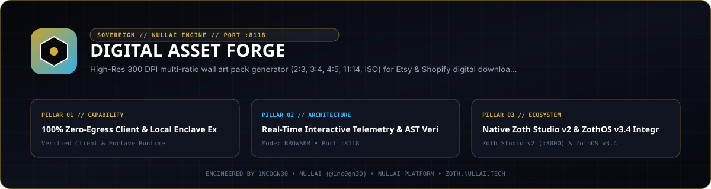

<div align="center">
  
</div>

# Digital Asset Forge

High-resolution 300 DPI multi-ratio wall art pack calculator, Etsy 20 MB archive splitter, customer printing guide builder, and SEO listing generator for digital downloads.

- **Repository**: `https://github.com/1nc0gn30/digital-asset-forge`
- **Zoth Studio v2 Dossier**: `https://zoth.nullai.tech/tools/digital-asset-forge`
- **Local Workstation**: `http://127.0.0.1:8118`
- **Version**: `2.5.0`
- **Author**: 1nc0gn30 (`@1nc0gn30`, `https://1nc0gn30.si`) • NullAI (`https://nullai.tech`)
- **License**: MIT (100% free and open-source; zero paywalls)

---

## Overview

Digital Asset Forge computes 300 DPI master pixel dimensions, centered aspect-ratio crop boxes, multi-archive ZIP bundle plans under Etsy's 20 MB per-file upload cap, customer printing instructions, and 13-tag Etsy listing metadata. Both the Python HTTP/CLI backend and the browser UI execute locally with zero third-party Python runtime dependencies.

### Supported 300 DPI Ratio Families

| Ratio Key | Master Print Size | Master 300 DPI Resolution | Compatible Frame Sizes |
| :--- | :--- | :--- | :--- |
| `2x3` | `24" x 36"` | `7200 x 10800 px` | `4x6`, `6x9`, `8x12`, `10x15`, `12x18`, `16x24`, `20x30`, `24x36` in |
| `3x4` | `18" x 24"` | `5400 x 7200 px` | `6x8`, `9x12`, `12x16`, `15x20`, `18x24` in |
| `4x5` | `16" x 20"` | `4800 x 6000 px` | `4x5`, `8x10`, `12x15`, `16x20` in |
| `11x14` | `11" x 14"` | `3300 x 4200 px` | `11x14`, `22x28` in |
| `iso` | `A1 (594 x 841 mm)` | `7016 x 9933 px` | `A5`, `A4`, `A3`, `A2`, `A1`, `5x7` in |

---

## Architecture

```
digital-asset-forge/
├── server.py                              # Daemon entrypoint binding 127.0.0.1:8118
├── bin/
│   ├── digital-asset-forge                # CLI entrypoint wrapper
│   └── digital-asset-forge-tui            # ZothOS v3.4.0 Unicode U+2800 Braille TUI
├── src/digital_asset_forge/
│   ├── ratios.py                          # 300 DPI dimension tables, DPI audit & centered crop math
│   ├── pack_generator.py                  # Multi-ratio manifest & <=20 MB Etsy ZIP bundle planner
│   ├── printing_guide.py                  # Markdown & JSON customer printing guide generator
│   ├── etsy_copywriter.py                 # Title, 13 search tags (<=20 chars), fee & margin calculator
│   ├── server.py                          # Threaded HTTP server with Origin CSRF guard
│   ├── mcp_server.py                      # JSON-RPC 2.0 stdio MCP server (6 tools)
│   └── cli.py                             # Command-line interface
├── public/                                # Standalone client-side workstation UI
└── tests/                                 # Unit, loopback bind, and CSRF origin guard tests
```

### REST API Endpoints (`http://127.0.0.1:8118`)

All `POST` routes enforce a local `Origin` header check (`localhost`, `127.0.0.1`, `::1`, or non-browser CLI clients without `Origin`).

| Method | Path | Description |
| :--- | :--- | :--- |
| `GET` | `/health` | Service health status, version (`2.5.0`), port, and uptime |
| `GET` | `/api/stats` | Session telemetry counters and uptime |
| `GET` | `/api/ratios` | Full 5-family 300 DPI ratio specification table |
| `POST` | `/api/generate_pack` | Generate multi-ratio pack manifest and 20 MB ZIP split (`artwork_title`, `artist_name`) |
| `POST` | `/api/printing_guide` | Generate structured customer printing instructions (`artwork_title`, `shop_name`) |
| `POST` | `/api/etsy_copy` | Generate Etsy title, 13 tags (`<=20` chars), and fee/margin breakdown (`artwork_title`, `niche`, `retail_price_usd`) |
| `POST` | `/api/validate_dpi` | Audit effective DPI against physical target inches (`pixel_width`, `pixel_height`, `target_width_inches`, `target_height_inches`) |

---

## Quickstart

```bash
git clone https://github.com/1nc0gn30/digital-asset-forge.git
cd digital-asset-forge

# Optional editable install for the console script
pip install -e .

# Start the local HTTP server on 127.0.0.1:8118
python3 server.py --port 8118
```

Verify the running server from another terminal:

```bash
curl -s http://127.0.0.1:8118/health
curl -s http://127.0.0.1:8118/api/ratios
```

To bind an explicit interface (for example, a RFC 6598 Tailscale address `100.64.0.10`), pass `--host` or set `ZOTH_BIND_HOST`:

```bash
python3 server.py --host 127.0.0.1 --port 8118
```

---

## CLI & MCP Usage

### CLI Commands (`digital-asset-forge` / `./bin/digital-asset-forge`)

```bash
# Inspect CLI options, version, and JSON status
./bin/digital-asset-forge --help
./bin/digital-asset-forge --version
./bin/digital-asset-forge --status
./bin/digital-asset-forge --json

# Generate multi-ratio digital art pack manifest
./bin/digital-asset-forge manifest --title "Celestial Merkaba" --artist "1nc0gn30"
./bin/digital-asset-forge manifest --title "Celestial Merkaba" --json

# Audit source resolution against physical frame dimensions
./bin/digital-asset-forge dpi --width 7200 --height 10800 --target-w 24 --target-h 36

# Generate customer printing guide Markdown
./bin/digital-asset-forge guide --title "Celestial Merkaba" --shop "NullAI Studio"

# Generate Etsy SEO listing copy, 13 tags, and net margin report
./bin/digital-asset-forge etsy --title "Celestial Merkaba" --niche geometric --price 7.50 --json

# Launch HTTP daemon
./bin/digital-asset-forge server --port 8118
```

### ZothOS v3.4.0 Braille TUI Integration

On ZothOS v3.4.0, `digital-asset-forge` and `digital-asset-forge-tui` are installed in `/usr/local/bin` and integrated with the Zoth Studio v2 route (`https://zoth.nullai.tech/tools/digital-asset-forge`):

```bash
./bin/digital-asset-forge-tui --help
./bin/digital-asset-forge-tui --json
```

### MCP Server (`digital_asset_forge.mcp_server`)

Start the stdio JSON-RPC 2.0 MCP server:

```bash
PYTHONPATH=src python3 -m digital_asset_forge.mcp_server
```

Exposed MCP tools:
1. `forge_calculate_ratios` — Return all 5 wall art ratio families and 300 DPI dimensions.
2. `forge_generate_art_pack_manifest` — Build a multi-ratio file manifest and Etsy ZIP layout.
3. `forge_create_printing_guide` — Generate customer printing instructions and paper guidance.
4. `forge_generate_etsy_listing` — Produce Etsy title, 13 tags (`<=20` chars), and fee economics.
5. `forge_validate_image_dpi` — Audit source pixel dimensions (`MUSEUM_GRADE`, `ACCEPTABLE`, `DEFICIENT`).
6. `forge_optimize_zip_split` — Compute multi-ZIP archive splits under 20 MB per archive.

---

## Testing & Verification

```bash
python3 -m pytest -q
```

Test suites cover:
- `tests/test_asset_forge.py` — 5 ratio families, DPI thresholds, centered crop coordinates, 20 MB ZIP splitting, printing guide generation, and 13-tag `<=20`-character Etsy copy constraints.
- `tests/test_bind_host.py` — Default `127.0.0.1` loopback binding and `ZOTH_BIND_HOST` IP validation.
- `tests/test_origin_guard.py` — CSRF `Origin` header enforcement on mutating routes.

---

## Support

This project is 100% free and open-source with zero paywalls or feature gates. Optional support: [Buy Us a Coffee (Stripe)](https://buy.stripe.com/3cIfZg27PdKo2D64Ocfw40X).

## License

MIT License — Engineered by **1nc0gn30** (`@1nc0gn30`, `https://1nc0gn30.si`) • **NullAI** (`https://nullai.tech`).
